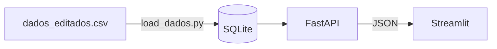

# Academic Analysis Project

> API + Dashboard to explore public academic data (31k records, 10 campuses, 107 courses).


[Versão em português](README.md)

## About
I built this project as an ETL exercise: I took a public dataset, created an API on top of it and a dashboard that consumes the API, to answer questions such as:
* How many records are in the dataset?
* How many courses are there?
* Which campus has the most records?
* How are records distributed by enrollment year?
* What is the cancellation rate among incoming students (*ingressantes*), by campus?

> **Terminology:** the dataset, database fields and API routes use Portuguese names. *Ingressantes* are incoming students and *concluintes* are graduating students.

**Data source:** [Alunos - Dados Abertos](https://dados.gov.br/dados/conjuntos-dados/12-alunos)
- Institution: Controladoria-Geral da União
- License: Open Data Commons Public Domain Dedication and License (PDDL)
- Accessed on: October 20, 2026
- Dataset period: 2022-2024

## Main Insights
* The dataset has 31,770 records. Since the data is partially anonymized, it is not possible to tell how many unique students they represent.
* There are 107 courses. **Técnico em Eletrotécnica** has the most records (1,727).
* **Campus Nova Suíça** has the most records: 13,442, against 6,368 for the second place.
* Records per enrollment year have exceeded 500 every year since 2007. The dataset combines graduating students (*concluintes*) with the 2022 incoming students (*ingressantes*), so the chart shows when graduates enrolled, not how enrollment evolved; the 2022 peak is mainly due to the incoming students.
* Cancellation among incoming students ranges from **1%** (Campus Contagem) to **10.7%** (Campus Nepomuceno). The samples are small, so rates for the smaller campuses fluctuate a lot.

## Architecture


## Technical Decisions
- **API separated from the dashboard:** the dashboard only consumes JSON and never accesses the database. You can swap the database or optimize queries without touching the frontend.
- **SQL aggregations:** calculations (counts, rates, rankings) run in the database, and the API returns only the result instead of loading every row into Python on each request.
- **Validation with Pydantic and `Literal`:** invalid parameters return a 422 error instead of an empty response with no explanation. This came from a test that revealed the `tipo` filter accepting any value.
- **SQLite:** simple and zero-configuration, adequate for the size of the data. Since access goes through SQLAlchemy, migrating to PostgreSQL should require few changes.
- **Docker Compose:** one image serves both services, and the database is generated at startup by `load_dados.py`, so the `.db` file doesn't need to be versioned.
- **Dashboard cache:** `st.cache_data` avoids repeating identical API calls while navigating.
- **Counting records, not people:** names are anonymized and abbreviated, so unique students can't be identified reliably.

## Technologies
Python, Pandas, SQLAlchemy, FastAPI, Pydantic, Streamlit, Plotly, Pytest, Docker.

## How to Run

### With Docker
**Requirements:** Docker with Compose
```bash
docker compose up --build
```
API at `http://localhost:8000/docs` and dashboard at `http://localhost:8501`.

### Locally
**Requirements:** Python 3.12
```bash
python -m venv .venv && source .venv/bin/activate
pip install -r requirements.txt
python load_dados.py
python run.py  # terminal 1
streamlit run dashboard/app.py  # terminal 2
```

## Endpoints
| Method | Route | Description |
|---|---|---|
| GET | `/alunos/resumo` | Overall totals |
| GET | `/alunos/opcoes` | Available values for the filters |
| GET | `/alunos/top-cursos` | Courses with the most records |
| GET | `/alunos/ano_ingresso` | Records by enrollment year |
| GET | `/alunos/cancelamento` | Cancellation rate among incoming students, by campus |
| GET | `/alunos/por-campus` | Records by campus |

## Data Limitations
- Names are anonymized and abbreviated: counts refer to records, not people.
- The cancellation rate only covers the 2022 incoming students.
- Enrollment years go back to 1983, although the dataset refers to 2022-2024.

## Tests
```bash
python load_dados.py  # generates the database used by the tests
pytest
```

## Structure
```text
ProjetoAnaliseAcademica/
├── .github
│   └── pull_request_template.md
├── dashboard
│   └── app.py                              # Streamlit dashboard
├── docs
│   └── dashboard.gif                       # GIF used in the README
├── src
│   ├── routes
│   │   └── alunos.py                       # API endpoints
│   ├── services
│   │   └── alunos.py                       # SQL queries and aggregations
│   ├── database.py                         # database connection
│   ├── main.py                             # FastAPI application
│   └── schema.py                           # Pydantic models
├── tests
│   └── test_api.py                         # API tests
├── .dockerignore
├── .gitignore
├── analise_exploratoria.ipynb              # exploratory analysis with Pandas
├── dados_editados.csv                      # cleaned dataset
├── docker-compose.yml
├── Dockerfile
├── LICENSE
├── load_dados.py                           # creates the database from the CSV
├── PDA_2022-2024_1.2_Alunos_Anonimo.csv    # original dataset
├── pytest.ini
├── README.en.md
├── README.md
├── requirements.txt
└── run.py                                  # starts the API locally
```

## Skills Exercised
* Exploratory data analysis with Pandas
* SQL and SQLAlchemy
* API creation and validation (FastAPI and Pydantic)
* Automated testing with Pytest
* Interactive dashboards with Streamlit and Plotly
* Docker and Docker Compose
* Git: branches and pull requests

## Next Steps
- Deploy the API and the dashboard
- Continuous integration with GitHub Actions
- New filters and metrics (e.g., by education level)

## License
The code is released under the [MIT License](LICENSE). The data follows the PDDL license of the [original source](https://dados.gov.br/dados/conjuntos-dados/12-alunos).

## Author
**Vitor Costa**: [LinkedIn](https://www.linkedin.com/in/vitorcosta98/) · [GitHub](https://github.com/vitorcosta98)