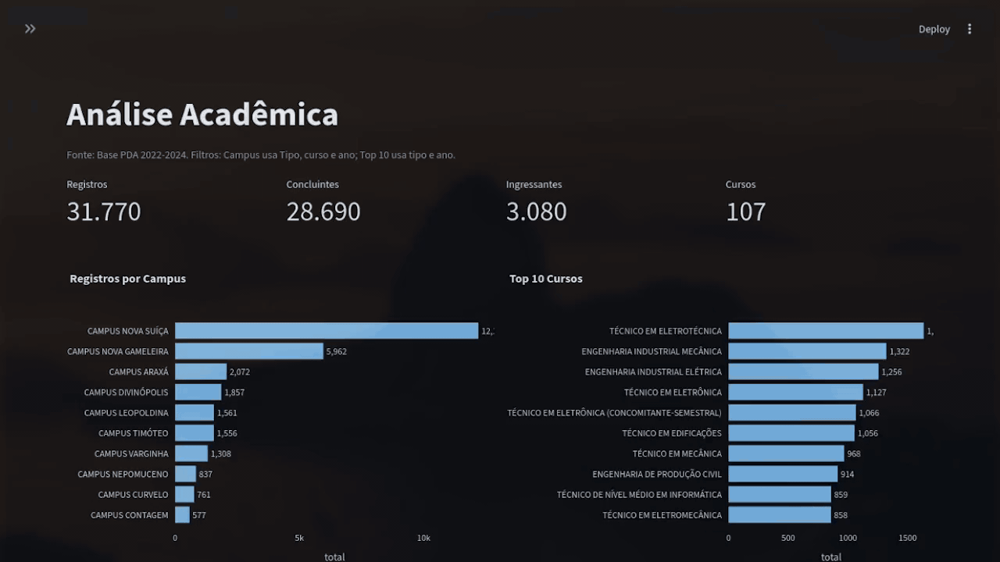
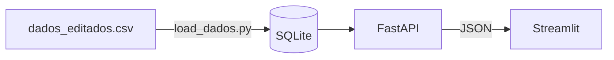

# Projeto Análise Acadêmica

> API + Dashboard para explorar dados acadêmicos públicos (31 mil registros, 10 campi, 107 cursos).



[English version](README.en.md)

## Sobre
Desenvolvi esse projeto como um exercício de ETL, onde utilizei uma base de dados pública e construí uma API para alimentar um dashboard e responder algumas perguntas de acordo com o dataset proposto.
* Quantos registros existem na base?
* Quantos cursos?
* Qual campus com mais registros?
* Como os registros se distribuem ao longo do tempo?
* Qual a taxa de cancelamento entre ingressantes, por campus?

**Fonte dos dados:** [Alunos - Dados Abertos](https://dados.gov.br/dados/conjuntos-dados/12-alunos). 
- Instituição: Controladoria-Geral da União
- Licença: Open Data Commons Public Domain Dedication and License (PDDL)
- Acesso em: 20 outubro 2026
- Período da Base: 2022-2024.

## Principais Insights
* Localizei mais de 30 mil registros, mas sem possibilidades de informar se são únicos, pois são dados parcialmente anonimizados;
* São 107 cursos no total, com destaque para **TÉCNICO EM ELETROTÉCNICA** como o curso com mais registros, com 1727 registros;
* O **CAMPUS NOVA SUÍÇA** é o campus com mais registros, 13.442 contra 6.368 do segundo colocado;
* Foi observado que o número de registros aumentou ao longo do tempo, desde 1985 até 2022, observando que a partir de **2007** os registros anuais superaram 500 regristros por ano;
* O máximo percentual de cancelamento é de **10,7%** na unidade **CAMPUS NEPOMUCENO** e o mínimo foi **1%** na unidade **CAMPUS CONTAGEM**, observando que são amostras pequenas, então as taxas dos campi menores oscilam bastante;

## Arquitetura


## Decisões Técnicas
- **API separada do dashboard:** o dashboard só consome JSON e nunca acessa o
  banco. Dá para trocar o banco ou otimizar consultas sem mexer no frontend.
- **Agregações em SQL:** os cálculos (contagens, taxas, rankings) rodam no banco,
  e a API devolve só o resultado, em vez de carregar todas as linhas no Python
  a cada requisição.
- **Validação com Pydantic e `Literal`:** parâmetros inválidos retornam erro 422
  em vez de uma resposta vazia sem explicação. Esse cuidado surgiu de um teste
  que revelou o filtro `tipo` aceitando qualquer valor.
- **SQLite:** simples e sem configuração, adequado ao volume da base. Como o
  acesso passa pelo SQLAlchemy, migrar para PostgreSQL tende a exigir poucas
  mudanças.
- **Docker Compose:** uma imagem serve aos dois serviços, e o banco é gerado na
  subida pelo `load_dados.py`, o que dispensa versionar o arquivo `.db`.
- **Cache no dashboard:** `st.cache_data` evita repetir chamadas idênticas à API
  durante a navegação.
- **Contagem de registros, não de pessoas:** os nomes são anonimizados e
  abreviados, então não há como identificar alunos únicos com segurança.

## Tecnologias
Python, Pandas, SQLAlchemy, FastAPI, Pydantic, Streamlit, Plotly, Pytest, Docker.

## Como Rodar

### Com Docker
**Requisitos: Docker Compose**
```bash
docker compose up --build
```
API em `http://localhost:8000/docs` e dashboard em `http://localhost:8501`.

### Localmente
**Requisitos: Python 3.12.3**
```bash
python -m venv .venv && source .venv/bin/activate
pip install -r requirements.txt
python load_dados.py
python run.py  # terminal 1
streamlit run dashboard/app.py # terminal 2
```

## Endpoints
| Método | Rota | Descrição |
|---|---|---|
|GET| `/alunos/resumo` | Totais Gerais da Base|
|GET| `/alunos/opcoes` | Valores Disponíveis Para os Filtros |
|GET| `/alunos/top-cursos`| Cursos Com Mais Registros |
|GET| `/alunos/ano_ingresso` | Registros Por Ano de Ingresso |
|GET| `/alunos/cancelamento` | Taxa de Cancelamento Entre Ingressantes, Por Campus |
|GET| `/alunos/por-campus` | Registros Por Campus |

## Limitações dos Dados
- Nomes anonimizados e abreviados: as contagens são de registros, e não de pessoas.
- A taxa de cancelamento considera só os ingressantes de 2022.
- O período de ingresso vai até 1983, embora a base seja de 2022-2024.

## Testes
```bash
python load_dados.py    # Gera o banco consultado pelos testes
pytest
```

## Estrutura
```text
ProjetoAnaliseAcademica/
├── .github
│   └── pull_request_template.md
├── dashboard
│   └── app.py                      # dashboard Streamlit
├── docs
│   └── dashboard.gif               # GIF usado no README
├── src
│   ├── routes
│   │   └── alunos.py               # endpoints API
│   ├── services
│   │   └── alunos.py               # consultas e agregações SQL
│   ├── database.py                 # conexão com o banco
│   ├── main.py                     # aplicação FastAPI
│   └── schema.py                   # modelos Pydantic
├── tests
│   └── test_api.py                 # testes API
├── analise_exploratoria.ipynb      # análise exploratória com Pandas
├── dados_editados.csv              # base tratada
├── docker-compose.yml
├── Dockerfile
├── LICENSE
├── .dockerignore
├── .gitignore
├── load_dados.py                   # cria o banco a partir do CSV
├── PDA_2022-2024_1.2_Alunos_Anonimo.csv
├── pytest.ini
├── README.en.md
├── README.md
├── requirements.txt
└── run.py                          # inicia a API localmente
```

## Habilidades Exercitadas
* Análise exploratória de dados com Pandas;
* SQL e SQLAlchemy ;
* Criação e validação de APIs (FastAPI e Pydantic);
* Testes automatizados com Pytest;
* Dashboards interativos com Streamlit e Plotly;
* Docker e Docker Compose;
* Git: Branches e Pull Requests;

## Próximos passos
- Deploy da API e do dashboard
- Integração contínua com GitHub Actions
- Novos filtros e métricas (por exemplo, por nível de ensino)

## Licença
Código sob licença [MIT](LICENSE).
<br>
Os dados seguem a licença PDDL da fonte original.([Alunos - Dados Abertos](https://dados.gov.br/dados/conjuntos-dados/12-alunos))

## Autor
**Vitor Costa**: [LinkedIn](https://www.linkedin.com/in/vitorcosta98/) · [GitHub](https://github.com/vitorcosta98)