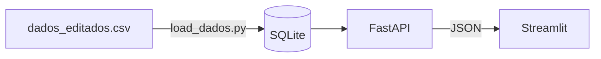

# Projeto Análise Acadêmica

> API + Dashboard para explorar dados acadêmicos públicos (31 mil registros, 10 campi, 107 cursos).

[Dashboard](docs/dashboard.gif)

[English version](README.en.md)

## Sobre
Desenvolvi esse projeto como um exercício de ETL, para responder algumas perguntas de acordo com o dataset proposto. 
* Quantos registros existem na base?
* Quantos Cursos?
* Quantos Campus?
* Qual o histórico de registros ao longo do tempo?
* Qual a taxa de cancelamento?

**Fonte dos dados:** [Alunos - Dados Abertos](https://dados.gov.br/dados/conjuntos-dados/12-alunos). Base referente a 2022-2024.

## Arquitetura


## Tecnologias
Python, Pandas, SQLAlchemy, FastAPI, Pydantic, Streamlit, Plotly, Pytest, Docker.

## Como rodar
**Com Docker**
```bash
docker compose up --build
```

API em `http://localhost:8000/docs` e dashboard em `http://localhost:8501`.

**Localmente**
```bash 
python -m venv .venv && source .venv/bin/activate
pip install -r requirements.txt
python load_dados.py
python run.py  # terminal 1 
streamlit run dashboard/app.py # terminal 2
```

## Endpoints
| Método | Rota | Descrição |
|---|---|---|
|GET| `/alunos/resumo` | Totais Gerais |
|GET| `/alunos/opcoes` | Valores dos Filtros |
|GET| `/alunos/por-campus` | Cursos com Mais Registros |
|GET| `/alunos/ano_ingresso` | Registros por Ano de Ingresso |
|GET| `/alunos/cancelamento` | Taxa de Cancelamento entre Ingressos |

## Limitações dos Dados
- Nomes anonimizados e abreviados: as contagens são de registros, e não de pessoas.
- A taxa de cancelamento considera só os ingressantes de 2022.

## Testes
```bash
pytest
```

## Estrutura


Pude exercitar essas habilidades:
* Análise de Dados;
* Manipulação de dados SQL 
* Criação e uso de API;
* Criação de testes;
* Criação de Dashboards Interativos;
* Docker;
* Testes Automatizados;
* Validação com Pydantic;
* Fluxo de Trabalho com Git (Branches e PRs);